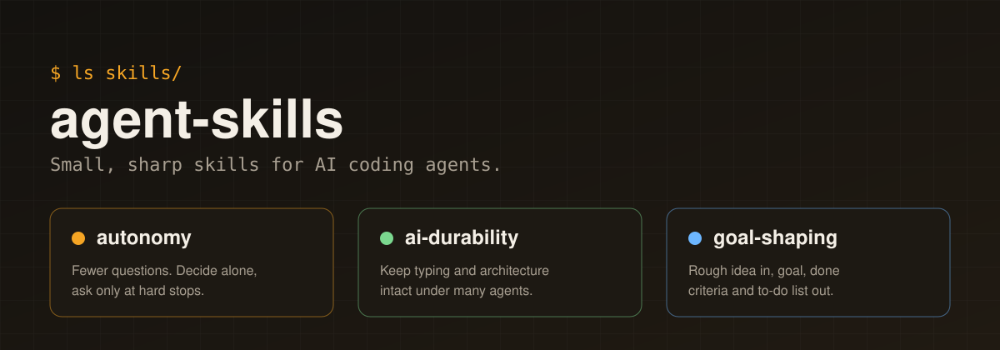

<p align="center"></p>

# agent-skills

**Site:** https://jovylle.github.io/agent-skills/

Agent skills I use and maintain. Each folder in `skills/` has a `SKILL.md`.

| Skill | What it does |
| --- | --- |
| [autonomy](skills/autonomy/SKILL.md) | Per-thread sticky mode that cuts questions: decide alone, get a second opinion from a delegate, ask only at hard stops. |
| [ai-durability](skills/ai-durability/SKILL.md) | Set up and audit a project so typing, architecture and agent rules hold while many agents work on it. |
| [goal-shaping](skills/goal-shaping/SKILL.md) | Turn a rough idea into a goal, checkable done criteria, and an ordered to-do list. |

## Install

Clone, then link the skills you want into your agent's skills folder:

```sh
git clone https://github.com/jovylle/agent-skills ~/agent-skills
ln -s ~/agent-skills/skills/autonomy ~/.agents/skills/autonomy
```

## License

MIT
